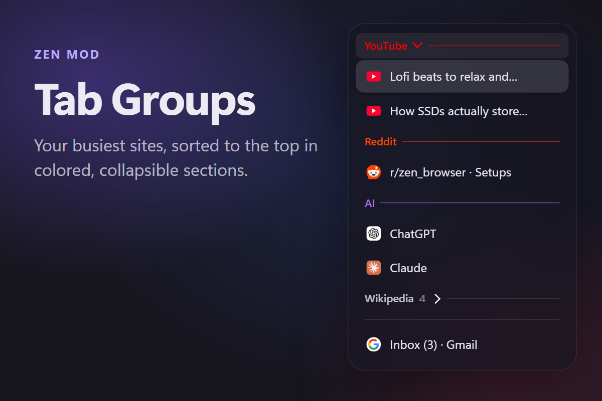
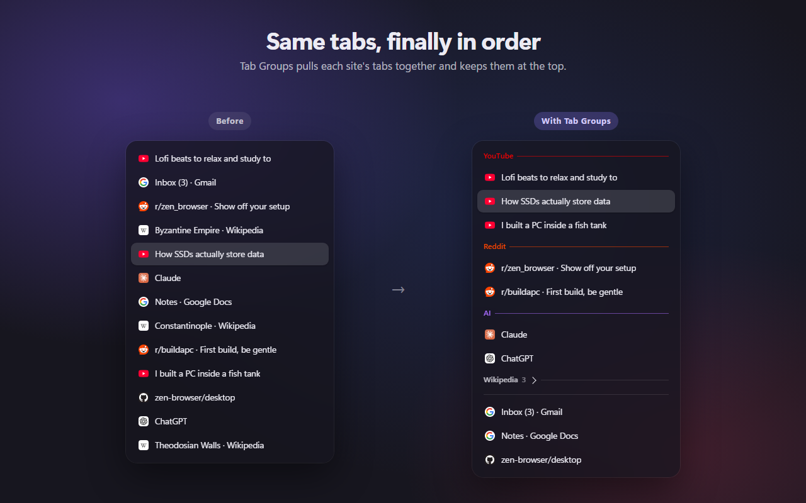
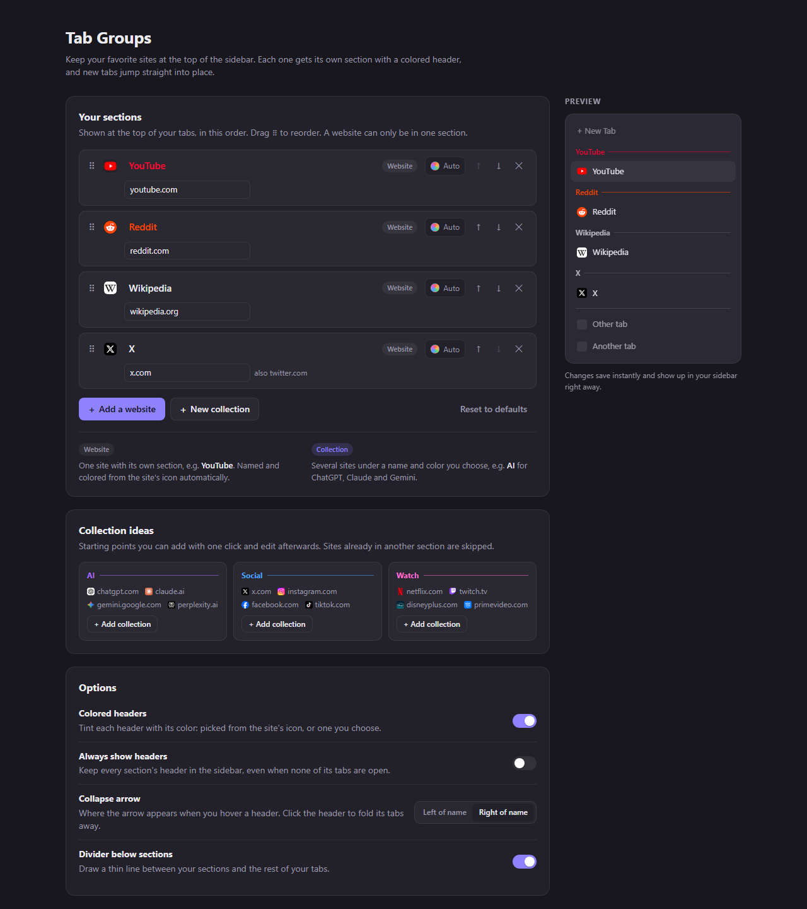

# Tab Groups for Zen

Keeps your busiest sites at the top of Zen's sidebar. Tabs from YouTube, Reddit or any site you pick jump into their own section the moment you open them, under a colored header you can collapse.

> **Zen Browser only** (tested on 1.23.2b). It relies on Zen's sidebar and workspaces, so it won't work in Firefox or other Firefox-based browsers.

## Features

- **Sorted automatically.** New tabs go straight into their section, in the order you choose. No dragging.
- **Colored headers.** Each header takes the main color of the site's logo, or a color you pick.
- **Collections.** Put several sites under one name, like ChatGPT, Claude and Gemini as "AI".
- **Fold away.** Hover a header to show the collapse arrow. Click it to hide the section's tabs, or click **Clear** to close them all.
- **Settings page** with a live preview, drag-to-reorder and ready-made collection ideas.

## Install

### With Sine (recommended)

[Sine](https://github.com/CosmoCreeper/Sine) is a mod manager for Zen that can run script mods like this one.

1. Install Sine if you don't have it yet.
2. In Zen, open **Settings → Sine Mods**.
3. This mod runs JavaScript, so until it's listed in Sine's store, turn on installing JS from unofficial sources in Sine's settings.
4. Install it from GitHub by entering `oom333/zen-tab-groups`.
5. Restart Zen.

### Manually (fx-autoconfig)

1. Set up [fx-autoconfig](https://github.com/MrOtherGuy/fx-autoconfig) in Zen.
2. Copy `tab-groups.uc.js` **and** the `tab-groups` folder into your profile's `chrome/JS/` folder. Find your profile folder in `about:support` → **Profile Folder**.
3. In `about:support`, click **Clear startup cache…**, then restart Zen.

## Using it

Out of the box you get sections for **YouTube, Reddit, Wikipedia and X**.

- **Right-click a tab** → *Give this site its own section*, or add it to a collection.
- **Right-click a header** → move it up or down, rename it, remove it, close all its tabs, or open the settings.
- **Settings page:** right-click any header or tab → **Tab Groups settings…**

### Website vs. collection

- **Website:** one site with its own section, like YouTube. It's named and colored from the site's icon automatically.
- **Collection:** several sites under a name and color you choose.

A website can only be in one section. The most specific address wins, so `music.youtube.com` can have its own section next to `youtube.com`.

### Options

Available on the settings page, and in Sine's settings for the mod:

- **Colored headers:** on by default.
- **Always show headers:** keeps a section's header even when none of its tabs are open.
- **Collapse arrow:** right of the name (default) or left of it.
- **Divider below sections:** a thin line between your sections and your other tabs.

## Notes

- To pick header colors, the mod looks at each site's icon. It uses icons Zen already has saved, and otherwise loads `https://<site>/favicon.ico` once. The colors are saved, so this only happens the first time.
- Settings are stored as `zen.sitegroups.*` prefs in `about:config`.

## License

[MIT](LICENSE)
